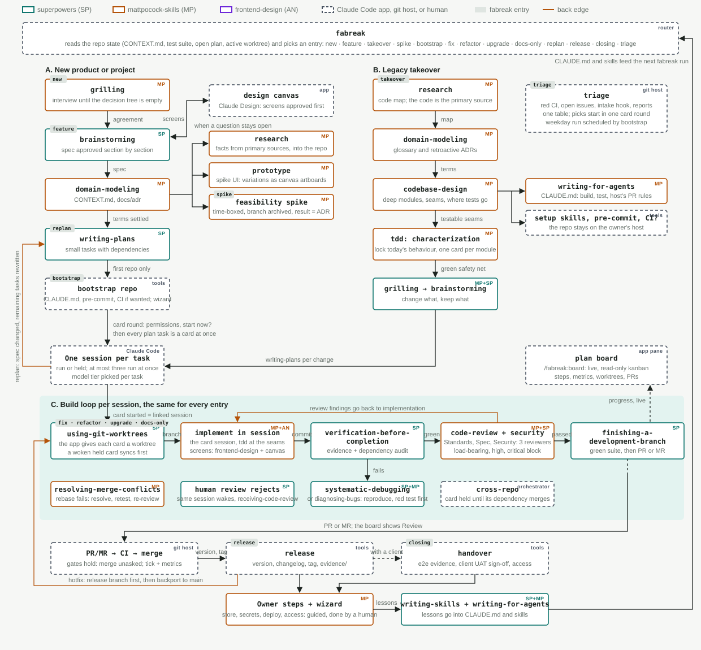

# fabreak

fabreak is a Claude Code plugin that runs the Agentic Development Lifecycle (ADLC): one command per entry (`/fabreak:new`, `/fabreak:fix`, `/fabreak:release`, and so on) and a router, `/fabreak`, that reads the state of a repository and picks the entry. Every entry then invokes the right skills from [superpowers](https://github.com/obra/superpowers), [mattpocock-skills](https://github.com/mattpocock/skills) and [frontend-design](https://github.com/anthropics/claude-plugins-official/tree/main/plugins/frontend-design) in a fixed order. It copies nothing from those skills; it routes to them.

Three parties take part: the repo owner, the orchestrator session where a `/fabreak` command was typed, and one task session per card, which implements its task while fresh subagents review it. Roles are skills, not named agents.

fabreak is built for the Code tab of the Claude desktop app: cards are app sessions, each in its own worktree, and the plan board opens in the app's preview pane. In a plain terminal the board is printed as text instead.



## Install

Prerequisites, installed as plugins at user scope:

| Plugin | Repo |
|---|---|
| superpowers | https://github.com/obra/superpowers |
| mattpocock-skills | https://github.com/mattpocock/skills |
| frontend-design | https://github.com/anthropics/claude-plugins-official |

Tools on `PATH`: `git`; `python3` for the plan board (standard library only); `gh`, `glab` or nothing for GitHub, GitLab or Bitbucket, as hosting goes.

Then:

```bash
claude plugin marketplace add https://github.com/yanuarif/fabreak
claude plugin install fabreak@fabreak --scope user
```

Add one line to the `CLAUDE.md` of every repo that should use it:

```
Every development request starts with /fabreak
```

## Entries

`/fabreak` (the router, listed as `/fabreak:fabreak`) reads the repo state and picks an entry, asking one question when two fit. `/fabreak:<entry>` goes straight there; the request can follow it on the same line, as in `/fabreak:fix totals are off by one cent`.

| Entry | Enter when |
|---|---|
| `/fabreak:new` | an empty or nearly empty repo; a product shaped from scratch |
| `/fabreak:feature` | a change to a repo that has `CONTEXT.md` |
| `/fabreak:takeover` | first contact with code that has no domain model |
| `/fabreak:spike` | a feasibility question that needs throwaway code, time-boxed |
| `/fabreak:bootstrap` | a repo needs `CLAUDE.md`, pre-commit, branch protection, CI when wanted |
| `/fabreak:fix` | a bug report |
| `/fabreak:refactor` | structure changes, behaviour stays |
| `/fabreak:upgrade` | a dependency, runtime or platform version jump |
| `/fabreak:docs-only` | documentation changes only |
| `/fabreak:replan` | the spec changed while plan tasks remain |
| `/fabreak:release` | every plan card is Done and the default branch is green |
| `/fabreak:closing` | handover to a client: UAT, evidence, access |
| `/fabreak:triage` | open issues, a red default branch or a repository's intake hook to sort into cards |
| `/fabreak:board` | open the live, read-only plan board in the preview pane |

Flags: `/fabreak:feature --grill` runs a grilling interview before brainstorming; `/fabreak:fix --release` lands the fix on the release branch first, then backports it.

## What it enforces

- Plan before code, except for `fix`, `refactor`, `upgrade` and `docs-only`.
- A change with screens is designed on a Claude Design canvas and approved before its spec is written; the cards that build those screens implement against the canvas.
- One task = one card = one session = one worktree = one PR or MR.
- Reviewers are fresh subagents; the implementer never reviews its own work.
- Each card starts on a model tier picked from its task: a mechanical task on the cheaper tier, a task with a design choice left on the orchestrator's own. Reviewers of a small diff run on the cheaper tier too.
- Every review runs mattpocock-skills:code-review on two axes, Standards and Spec, plus a security axis in a third fresh subagent (Claude Code's `security-review` skill); docs-only runs Standards alone. Load-bearing findings, security findings rated high or critical among them, go back for one fix round; cosmetic ones go in the PR description.
- Verify runs the dependency audit of each package manager in the repository (`npm audit`, `pip-audit`, `cargo audit`, `govulncheck` and others, when installed). An advisory on a package the branch added or changed blocks the merge; one already on the default branch becomes an `upgrade` follow-up.
- A card merges without asking when the card round granted merge, CI is green (or, with no CI or a CI the host never started, the local evidence is in the PR body), the last review had no load-bearing finding, the PR body's `Skills:` line names every skill the loop requires and no human review requests changes. Granting merge adds the host's merge command to the repository's `.claude/settings.local.json` allow list so the permission classifier lets the card's merge through. Otherwise the card asks, naming the gate that does not hold. The orchestrator never merges a card's PR, and ticks a task only from the card's merge report.
- A stack several cards share (staging, a shared database, a device) is used under a lock in the repository's common git folder; a card stops or resets only a stack whose lock it holds.
- Verification evidence is command output: the test runner's summary line and exit code, printed verbatim.
- Steps only a human can take (secrets, deploys, store consoles, branch protection, access) run through a wizard and stop the session until the owner reports them done.
- A question stops the session, never a guess, and the message alone answers it: an interview round (grilling, brainstorming, spec approval) is plain chat, a discrete choice uses the app's question tool, and the closing box's buttons are kept for git go-aheads.
- The plan in git is the durable record, edited by the orchestrator only: tasks are ticked when their PR merges, each with a `Metrics:` line (lead, work, review rounds, load-bearing findings, tier); replans, archived spikes and wrong task splits are recorded there. A task session reports plan findings in its PR body under "For the plan".

## How a plan runs

1. The orchestrator writes the spec and the plan with the entry's skills and commits them.
2. Card round: one question settles the git permissions every card gets (commit; push and open the PR or MR; merge) and whether to start now.
3. Every unchecked task becomes a card in the same turn, a session of its own with its own worktree and a brief carrying the task's plan text. At most three run at once; the rest are held until the tasks they depend on merge.
4. Each running card follows loop C: check the worktree (a held card syncs it first), implement with TDD, verify with the dependency audit, review on three axes, open the PR or MR, and merge, on its own when the merge gates hold and the owner granted merge, otherwise on the owner's go-ahead.
5. On the card's merge report the orchestrator ticks the task in the plan and wakes the held cards whose dependencies are now ticked.

## Plan board

`/fabreak:board`, or the router when a plan is open, starts `scripts/plan-board.py` and opens its page in the preview pane: a live, read-only kanban of `docs/superpowers/plans/*.md` with four columns, Backlog, In progress, Review and Done.

- A task's column comes from three sources: its steps, the worktree on its branch (a commit past the default branch or an uncommitted change is In progress) and its PR (open is Review, merged is Done). PR state needs `gh` and a GitHub remote.
- Steps are read from the plan, from the plan's copy in the task's worktree, and from the progress file the task session keeps in its worktree's private git folder, so a card in flight shows its steps as they happen. Markers: `- [ ]` open, `- [/]` in progress, `- [x]` done, `- [-]` skipped.
- A branch belongs to a task by its title or by its number (`03-editor`, `task-3`).
- Each card shows its metrics: model tier, review rounds, load-bearing findings, lead time (card start to merge) and work time (first step to merge). They come from the plan's `Metrics:` line once the task is ticked, and live from the progress file before that. The header sums them for the plan: Done count, median lead and work, review rounds, load-bearing findings and tier mix.
- Changes reach the page over Server-Sent Events. A card opens its details: dependencies, branch, worktree, PR and the task's plan text. The page has search (`/`), column filters, keyboard navigation, a plan picker when there are several plans, and an activity log.
- The server listens on 127.0.0.1 only, on a port derived from the repository path, and writes nothing. It stops when the session that started it ends, or from the page's Stop button.

## Layout

```
skills/fabreak/SKILL.md      the router: state detection, entry table, rules for every entry
skills/<entry>/SKILL.md      one skill per entry, the /fabreak:<entry> command; read by the router only when that entry is chosen
skills/fabreak/board.md      cards: card round, tier, brief, held cards, state, plan board, CLI fallback
skills/fabreak/loop.md       loop C: worktree, implement, verify, review, finish, merge
skills/fabreak/design.md     the design step: screens on a Claude Design canvas, approved before the spec
skills/fabreak/hosting.md    GitHub, GitLab, Bitbucket: PR or MR, CI status, merge, protection
skills/triage/SKILL.md       the /fabreak:triage entry: issues, red CI and the intake hook sorted into cards; its log is docs/superpowers/triage.md
skills/board/SKILL.md        the /fabreak:board command: starts the plan board and opens it in the preview pane
scripts/plan-board.py        the plan board server: plan ticks, metrics, worktrees and PRs pushed live to one read-only page, 127.0.0.1
tests/                       fixtures for dry runs, shell tests, plan board unit tests
scripts/task-worktree.sh     router state check 4: is this checkout a task worktree
```

## Limits

- fabreak creates no sidebar sections and moves no sessions: per-card state is on the card's row, in the plan and on the plan board. The board is read-only; in the terminal CLI, fabreak prints it as text from the plan and `git worktree list`.
- The plan board reads PR state from GitHub only; on GitLab and Bitbucket its columns come from steps and worktrees.
- Scheduled triage needs the desktop app: `bootstrap` offers a weekday `/fabreak:triage` as one of the app's scheduled tasks, which runs while the app is open. A scheduled run stops at the triage table; cards start only on the owner's answer. Without the app, triage is run by hand.
- CI is optional. `bootstrap` asks whether to write a CI workflow; without CI, the local suite run's summary lines and exit codes stand in for CI green and go in the PR or MR body.
- The PR monitor that wakes a session on review comments, and Auto-fix, exist only for GitHub. On GitLab the session uses `glab`; on Bitbucket it uses the REST API or prints manual steps, and checks CI status itself.
- fabreak is for development work. Business development, hypothesis research and project-specific tooling are out of scope; a repo may name its own verification hook and intake hook in `CLAUDE.md`, and fabreak calls them when they exist.

## Contributing

See [CONTRIBUTING.md](CONTRIBUTING.md). Licensed under the [MIT License](LICENSE).
